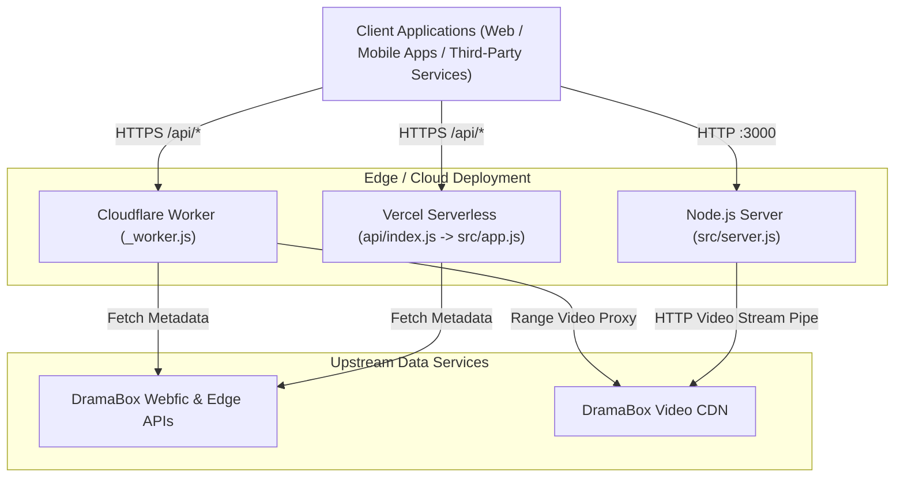

# DramaBox API Architecture Documentation

## 1. High-Level Architecture Overview

**DramaBox API** is designed as a dual-runtime, edge-first API architecture. It provides identical endpoints whether executed as a Cloudflare Edge Worker, a Vercel Serverless Function, or a standalone Node.js Express server.

---

## 2. Core Architecture Components

### 2.1 Dual-Runtime Design

1. **Cloudflare Edge Worker (`_worker.js`)**:
   - Zero external dependency footprint.
   - Built on native Web Standards (`Request`, `Response`, `fetch`, `Headers`).
   - Handles byte-range video proxying and automatic 307 CDN redirect fallback.
   - In-memory short-term drama chapter cache.

2. **Express.js Engine (`src/app.js`, `src/routes/api.js`, `src/controllers/`)**:
   - Used for Node.js standalone daemon execution (`src/server.js`) and Vercel Serverless Functions (`api/index.js`).
   - Modular MVC design: Routes -> Controllers -> Services.
   - Custom byte-range parsing and node `http`/`https` streaming with timeout protection.

---

## 3. Video Stream Delivery Pipeline

Vertical drama playback requires responsive scrubbing and cross-origin compatibility:

1. **CORS Handling**:
   - Headers: `Access-Control-Allow-Origin: *`
   - Allowed headers: `Range, Accept-Ranges, Content-Type, Authorization`
   - Exposed headers: `Content-Range, Content-Length, Accept-Ranges, X-Real-Video, X-Stream-Fallback`

2. **HTTP 206 Byte-Range Proxying**:
   - Evaluates incoming client `Range` header (e.g. `bytes=0-`).
   - Queries upstream CDN with forwarded `Range` request.
   - Pipes raw byte chunks directly to the response with accurate `Content-Range` and `Content-Length`.

3. **307 Redirect Fallback**:
   - If the upstream CDN blocks cloud/datacenter IP ranges with 403 Forbidden, the proxy automatically responds with an HTTP `307 Temporary Redirect` directly to the authenticated CDN media URL so the client browser/player directly streams the media.

---

## 4. Error Handling & Resilience

- **Uniform 404 Handlers**: All unmatched routes return a standardized JSON error message.
- **Graceful Category Fallbacks**: Undefined or invalid category IDs seamlessly fall back to default catalog browsing instead of throwing 500 errors.
- **In-Memory Cache**: Upstream chapter and episode metadata are cached in memory for 5 minutes (300,000 ms) to reduce upstream roundtrips and avoid rate limits.
