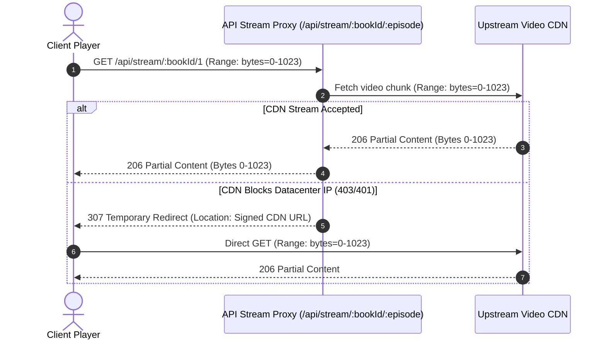

# DramaBox API System Specification

## 1. System Overview

**DramaBox API** is a high-performance, edge-ready REST API and video streaming proxy service for vertical short dramas and mini-series. It provides unified, standardized JSON endpoints for discovering dramas, browsing genres, searching titles, fetching chapter metadata, and streaming MP4 episodes with HTTP 206 Byte-Range support and automatic CDN fallback.

The service is architected to run seamlessly across multiple environments:
- **Cloudflare Workers**: Serverless edge execution with global CDN routing.
- **Vercel Serverless**: Node.js serverless functions powered by Express.
- **Node.js / Docker**: Standard containerized or standalone daemon service.

---

## 2. Runtime Environments

```
┌─────────────────────────────────────────────────────────────┐
│                    DramaBox API Runtimes                    │
├──────────────────────────────┬──────────────────────────────┤
│       Cloudflare Edge        │   Node.js / Vercel Serverless│
├──────────────────────────────┼──────────────────────────────┤
│ • _worker.js (Advanced Mode) │ • Express.js (src/app.js)    │
│ • Zero external dependencies │ • Vercel function (api/index)│
│ • Native fetch & Response    │ • Node.js server (src/server)│
│ • Instant cold start (<5ms)  │ • Configurable outbound proxy│
└──────────────────────────────┴──────────────────────────────┘
```

---

## 3. Core API Endpoints

All API endpoints return standardized JSON envelopes unless otherwise noted.

### 3.1 Metadata & Discovery Endpoints

| Endpoint | Method | Query / Path Params | Description |
| :--- | :---: | :--- | :--- |
| `/` | `GET` | None | API status, metadata, and complete endpoint index |
| `/api/health` | `GET` | None | Service health status, uptime, and configuration |
| `/api/ping` | `GET` | None | Upstream latency and connectivity check |
| `/api/token` | `GET` | None | Status of DramaBox upstream token bootstrap |
| `/api/homepage` | `GET` | None | Aggregated discovery feed (Trending, Recommended, Latest) |
| `/api/latest` | `GET` | `page=1`, `pageSize=20` | Chronological drama releases |
| `/api/trending` | `GET` | None | Top trending short dramas |
| `/api/recommended` | `GET` | None | Recommended titles for consumers |
| `/api/for-you` | `GET` | `page=1` | Personalized paginated recommendations |
| `/api/random` | `GET` | None | Single random drama pick for spotlighting |
| `/api/coming-soon` | `GET` | None | Upcoming and unreleased titles |
| `/api/dub-indo` | `GET` | `page=1`, `pageSize=15` | Indonesian dubbed short drama feed |
| `/api/categories` | `GET` | `page=1`, `pageSize=20` | Available drama genres and categories |
| `/api/category/:id` | `GET` | `:id` (category ID), `page=1` | Dramas filtered by category ID |
| `/api/search` | `GET` | `q=:query` or `keyword=:query` | Full-text drama title/tag search |
| `/api/search/suggest` | `GET` | `q=:query` | Typeahead search suggestions |
| `/api/search/popular` | `GET` | None | Trending search search terms |

### 3.2 Drama Details & Streaming Endpoints

| Endpoint | Method | Path Params | Description |
| :--- | :---: | :--- | :--- |
| `/api/drama/:bookId` | `GET` | `:bookId` | Comprehensive drama details and synopsis |
| `/api/drama/:bookId/related` | `GET` | `:bookId` | Related drama recommendations ("More Like This") |
| `/api/drama/:bookId/chapters` | `GET` | `:bookId` | Complete episode/chapter list with lock status |
| `/api/drama/:bookId/episode/:episode` | `GET` | `:bookId`, `:episode` | Episode details with proxy `streamUrl` |
| `/api/drama/:bookId/stream-url/:episode` | `GET` | `:bookId`, `:episode` | Direct stream URL payload (`zhadevv` schema) |
| `/api/stream/:bookId/:episode` | `GET` | `:bookId`, `:episode` | Video streaming proxy with HTTP 206 Byte-Range support |

---

## 4. Response Schemas

### Standard API Envelope

```json
{
  "success": true,
  "data": { ... },
  "message": null
}
```

### Stream URL Payload Schema (`/api/drama/:bookId/stream-url/:episode`)

```json
{
  "success": true,
  "creator": "zhadevv",
  "data": {
    "status": "success",
    "apiBy": "dramabox",
    "data": {
      "bookId": "41000107296",
      "allEps": 76,
      "chapter": {
        "id": "581861139",
        "index": 1,
        "video": {
          "mp4": "https://hwztakavideo.dramaboxdb.com/dramabox/video/.../video.mp4",
          "m3u8": null
        }
      }
    }
  },
  "metadata": {},
  "message": null
}
```

---

## 5. Video Stream Delivery Pipeline

The streaming proxy supports standard HTML5 `<video>` players (Plyr, Video.js, iOS Safari, Android Chrome) with instant seeking:


